# Knowledge Graph

> Visual traceability graph connecting decisions, requirements, components, and phases.
> Last updated: Phase 5 (Dashboard & Cross-Browser Extension)

Source definition: [`graph/knowledge-graph.json`](file:///home/rajababu/intern/leetsync/graph/knowledge-graph.json)

```mermaid
flowchart TD
    phase_0["Phase 0: Capture Spike (Phase)"]
    phase_1["Phase 1: Scaffold & Infrastructure (Phase)"]
    phase_2["Phase 2: Identity & Sessions (Phase)"]
    phase_3["Phase 3: Ingestion Pipeline (Phase)"]
    phase_4["Phase 4: GitHub Publishing (Phase)"]
    phase_5["Phase 5: Dashboard (Phase)"]
    phase_6["Phase 6: Reliability & Release Readiness (Phase)"]
    comp_extension["Chrome & Firefox Extension (Component)"]
    comp_web["Web Dashboard (Component)"]
    comp_api["Go API (Component)"]
    comp_publisher["Go Publisher (Component)"]
    comp_kafka["Kafka Cluster (Component)"]
    comp_postgres["PostgreSQL DB (Component)"]
    comp_github["GitHub API (Component)"]
    topic_submissions["submissions (Topic)"]
    table_users["users (Table)"]
    table_github_connections["github_connections (Table)"]
    table_repositories["repositories (Table)"]
    table_devices["devices (Table)"]
    table_submissions["submissions (Table)"]
    ep_auth_github_start["GET /auth/github/start (Endpoint)"]
    ep_auth_github_callback["GET /auth/github/callback (Endpoint)"]
    ep_auth_logout["POST /auth/logout (Endpoint)"]
    ep_me["GET /me (Endpoint)"]
    ep_me_delete["DELETE /me (Endpoint)"]
    ep_devices_pair["POST /devices/pair (Endpoint)"]
    ep_devices_refresh["POST /devices/refresh (Endpoint)"]
    ep_devices_list["GET /devices (Endpoint)"]
    ep_devices_revoke["DELETE /devices/{deviceId} (Endpoint)"]
    ep_gh_repos["GET /github/repositories (Endpoint)"]
    ep_repos["POST /repositories (Endpoint)"]
    ep_repos_selected["GET/PUT /repositories/selected (Endpoint)"]
    ep_repos_verify["POST /repositories/verify (Endpoint)"]
    ep_sync_submissions["POST /sync/submissions (Endpoint)"]
    ep_sync_backfill["POST /sync/backfill (Endpoint)"]
    ep_sync_resend["GET /sync/resend-requests (Endpoint)"]
    ep_sync_status["GET /sync/status (Endpoint)"]
    ep_sync_submissions_list["GET /sync/submissions (Endpoint)"]
    ep_sync_retry["POST /sync/submissions/{id}/retry (Endpoint)"]
    ep_sync_pause["POST /sync/pause (Endpoint)"]
    ep_sync_resume["POST /sync/resume (Endpoint)"]
    ep_health_live["GET /health/live (Endpoint)"]
    ep_health_ready["GET /health/ready (Endpoint)"]
    D_01["Go backend stack (Decision)"]
    D_02["PostgreSQL metadata only (Decision)"]
    D_03["Kafka kept, code in messages (Decision)"]
    D_04["Extension-push capture (Decision)"]
    D_05["No backend polling, backfill (Decision)"]
    D_06["Kafka retention bounds code (Decision)"]
    D_07["Resend from extension on expiry (Decision)"]
    D_08["Kafka acks=all, no outbox (Decision)"]
    D_09["Metadata row at receive time (Decision)"]
    D_10["Accepted submissions only (Decision)"]
    D_11["Distinct file per submission (Decision)"]
    D_12["GitHub auth, rotating tokens (Decision)"]
    D_13["IP for display only (Decision)"]
    D_14["Existing repo, keep README (Decision)"]
    D_15["Two Go processes, React web (Decision)"]
    D_16["Docker Compose infra, dev.sh (Decision)"]
    D_17["Phase 0 capture spike first (Decision)"]
    D_18["GitHub App authorization (Decision)"]
    D_19["In-memory installation tokens (Decision)"]
    D_20["Drop DLQ topic, row status (Decision)"]
    D_21["Drop metrics endpoint, structured logs (Decision)"]
    D_22["First/last IP only, drop audit table (Decision)"]
    D_23["Defer repo creation API (Decision)"]
    D_24["64-bit submission IDs (Decision)"]
    FR_AUTH_01["FR-AUTH-01: GitHub OAuth sign-in (Requirement)"]
    FR_AUTH_02["FR-AUTH-02: Minimum GitHub scopes (Requirement)"]
    FR_AUTH_03["FR-AUTH-03: Cookies, CSRF, expiry (Requirement)"]
    FR_AUTH_04["FR-AUTH-04: Disconnect, revoke, delete (Requirement)"]
    FR_EXT_01["FR-EXT-01: Onboarding on install (Requirement)"]
    FR_EXT_02["FR-EXT-02: Device pairing session (Requirement)"]
    FR_EXT_03["FR-EXT-03: In-session LeetCode capture (Requirement)"]
    FR_EXT_04["FR-EXT-04: Extension min permissions (Requirement)"]
    FR_EXT_05["FR-EXT-05: Offline queue and backoff (Requirement)"]
    FR_EXT_06["FR-EXT-06: Extension popup status (Requirement)"]
    FR_ING_01["FR-ING-01: Submission payload schema (Requirement)"]
    FR_ING_02["FR-ING-02: Validation & rate limits (Requirement)"]
    FR_ING_03["FR-ING-03: User + ID deduplication (Requirement)"]
    FR_ING_04["FR-ING-04: Kafka ack before response (Requirement)"]
    FR_ING_05["FR-ING-05: Extension backfill (Requirement)"]
    FR_ING_06["FR-ING-06: No backend polling (Requirement)"]
    FR_GH_01["FR-GH-01: Repository creation (Requirement)"]
    FR_GH_02["FR-GH-02: Connect existing repository (Requirement)"]
    FR_GH_03["FR-GH-03: README safe handling (Requirement)"]
    FR_GH_04["FR-GH-04: Problem directory layout (Requirement)"]
    FR_GH_05["FR-GH-05: Deterministic commit message (Requirement)"]
    FR_GH_06["FR-GH-06: Serialized commits, no force (Requirement)"]
    FR_HIST_01["FR-HIST-01: Preserve distinct submissions (Requirement)"]
    FR_HIST_02["FR-HIST-02: Idempotent reprocessing (Requirement)"]
    FR_HIST_03["FR-HIST-03: Path check crash recovery (Requirement)"]
    FR_HIST_04["FR-HIST-04: Conflict detection (Requirement)"]
    FR_DASH_01["FR-DASH-01: Pause and resume sync (Requirement)"]
    FR_DASH_02["FR-DASH-02: Manual retry (Requirement)"]
    FR_DASH_03["FR-DASH-03: Accurate state display (Requirement)"]
    FR_DASH_04["FR-DASH-04: Read-only queries (Requirement)"]
    FR_ERR_01["FR-ERR-01: Transient failure retries (Requirement)"]
    FR_ERR_02["FR-ERR-02: Permanent failure handling (Requirement)"]
    FR_ERR_03["FR-ERR-03: Dead-letter queue (Requirement)"]
    FR_ERR_04["FR-ERR-04: Safe logs and metrics (Requirement)"]
    OQ_01["OQ-01: In-session capture & ToS (OpenQuestion)"]
    OQ_02["OQ-02: GitHub OAuth App vs GitHub App (OpenQuestion)"]
    OQ_03["OQ-03: Token encryption & key rotation (OpenQuestion)"]
    OQ_04["OQ-04: Existing repo files/README policy (OpenQuestion)"]
    OQ_05["OQ-05: Retention periods (IP, logs, Kafka) (OpenQuestion)"]
    OQ_06["OQ-06: Scale volume & production deployment (OpenQuestion)"]
    RISK_leetcode_changes["LeetCode markup/API changes (Risk)"]
    RISK_client_asserted_data["Client-asserted submission data (Risk)"]
    RISK_missed_submissions["Missed submissions when offline (Risk)"]
    RISK_code_in_kafka["Source code exposure in Kafka (Risk)"]
    RISK_retention_vs_outages["Retention expiry during outages (Risk)"]
    RISK_github_rate_limits["GitHub API rate limits (Risk)"]
    RISK_duplicate_processing["Duplicate processing on crash/retry (Risk)"]
    RISK_ip_privacy["IP address privacy regulations (Risk)"]
    RISK_scope_growth["Scope creep beyond MVP (Risk)"]
    pkg_config["internal/config (Package)"]
    pkg_telemetry["internal/telemetry (Package)"]
    pkg_database["internal/database (Package)"]
    pkg_queue["internal/queue (Package)"]
    pkg_api["internal/api (Package)"]
    pkg_auth["internal/auth (Package)"]
    pkg_devices["internal/devices (Package)"]
    file_dev_sh["dev.sh (File)"]
    file_docker_compose["docker-compose.yml (File)"]
    file_identity_test["tests/identity_sessions_integration_test.go (File)"]
    pkg_config -- "implements" --> FR_ERR_04
    pkg_telemetry -- "implements" --> FR_ERR_04
    pkg_database -- "implements" --> FR_ERR_04
    pkg_queue -- "implements" --> FR_ING_04
    pkg_api -- "implements" --> FR_ERR_04
    pkg_auth -- "implements" --> FR_AUTH_01
    pkg_auth -- "implements" --> FR_AUTH_03
    pkg_auth -- "implements" --> FR_AUTH_04
    pkg_devices -- "implements" --> FR_EXT_02
    pkg_devices -- "implements" --> D_12
    pkg_devices -- "implements" --> D_13
    file_dev_sh -- "implements" --> D_16
    file_docker_compose -- "implements" --> D_16
    file_identity_test -- "implements" --> FR_AUTH_01
    FR_AUTH_01 -- "belongs_to" --> phase_2
    FR_AUTH_02 -- "belongs_to" --> phase_2
    FR_AUTH_03 -- "belongs_to" --> phase_2
    FR_AUTH_04 -- "belongs_to" --> phase_2
    FR_EXT_01 -- "belongs_to" --> phase_5
    FR_EXT_02 -- "belongs_to" --> phase_2
    FR_EXT_03 -- "belongs_to" --> phase_0
    FR_EXT_04 -- "belongs_to" --> phase_0
    FR_EXT_05 -- "belongs_to" --> phase_3
    FR_EXT_06 -- "belongs_to" --> phase_5
    FR_ING_01 -- "belongs_to" --> phase_3
    FR_ING_02 -- "belongs_to" --> phase_3
    FR_ING_03 -- "belongs_to" --> phase_3
    FR_ING_04 -- "belongs_to" --> phase_3
    FR_ING_05 -- "belongs_to" --> phase_3
    FR_ING_06 -- "belongs_to" --> phase_3
    FR_GH_01 -- "belongs_to" --> phase_4
    FR_GH_02 -- "belongs_to" --> phase_4
    FR_GH_03 -- "belongs_to" --> phase_4
    FR_GH_04 -- "belongs_to" --> phase_4
    FR_GH_05 -- "belongs_to" --> phase_4
    FR_GH_06 -- "belongs_to" --> phase_4
    FR_HIST_01 -- "belongs_to" --> phase_4
    FR_HIST_02 -- "belongs_to" --> phase_4
    FR_HIST_03 -- "belongs_to" --> phase_4
    FR_HIST_04 -- "belongs_to" --> phase_4
    FR_DASH_01 -- "belongs_to" --> phase_5
    FR_DASH_02 -- "belongs_to" --> phase_5
    FR_DASH_03 -- "belongs_to" --> phase_5
    FR_DASH_04 -- "belongs_to" --> phase_5
    FR_ERR_01 -- "belongs_to" --> phase_4
    FR_ERR_02 -- "belongs_to" --> phase_4
    FR_ERR_03 -- "belongs_to" --> phase_4
    FR_ERR_04 -- "belongs_to" --> phase_1
    FR_ING_01 -- "decided_by" --> D_01
    FR_HIST_01 -- "decided_by" --> D_02
    FR_HIST_02 -- "decided_by" --> D_02
    FR_ING_04 -- "decided_by" --> D_03
    FR_ERR_03 -- "decided_by" --> D_03
    FR_EXT_03 -- "decided_by" --> D_04
    FR_EXT_04 -- "decided_by" --> D_04
    FR_ING_05 -- "decided_by" --> D_05
    FR_ING_06 -- "decided_by" --> D_05
    FR_ERR_01 -- "decided_by" --> D_06
    FR_DASH_02 -- "decided_by" --> D_07
    FR_ING_04 -- "decided_by" --> D_08
    FR_DASH_03 -- "decided_by" --> D_09
    FR_ING_02 -- "decided_by" --> D_10
    FR_GH_04 -- "decided_by" --> D_11
    FR_GH_05 -- "decided_by" --> D_11
    FR_GH_06 -- "decided_by" --> D_11
    FR_HIST_01 -- "decided_by" --> D_11
    FR_AUTH_01 -- "decided_by" --> D_12
    FR_EXT_02 -- "decided_by" --> D_12
    FR_AUTH_03 -- "decided_by" --> D_13
    FR_GH_01 -- "decided_by" --> D_14
    FR_GH_02 -- "decided_by" --> D_14
    FR_GH_03 -- "decided_by" --> D_14
    FR_ERR_04 -- "decided_by" --> D_15
    FR_ERR_04 -- "decided_by" --> D_16
    FR_EXT_03 -- "decided_by" --> D_17
    FR_AUTH_02 -- "decided_by" --> D_18
    FR_AUTH_02 -- "decided_by" --> D_19
    FR_ERR_03 -- "decided_by" --> D_20
    FR_ERR_04 -- "decided_by" --> D_21
    FR_AUTH_04 -- "decided_by" --> D_22
    FR_GH_01 -- "decided_by" --> D_23
    FR_ING_01 -- "decided_by" --> D_24
    comp_extension -- "calls" --> ep_sync_submissions
    comp_extension -- "calls" --> ep_sync_backfill
    comp_extension -- "calls" --> ep_sync_resend
    comp_extension -- "calls" --> ep_devices_pair
    comp_extension -- "calls" --> ep_devices_refresh
    comp_web -- "calls" --> ep_auth_github_start
    comp_web -- "calls" --> ep_auth_github_callback
    comp_web -- "calls" --> ep_me
    comp_web -- "calls" --> ep_devices_list
    comp_web -- "calls" --> ep_devices_revoke
    comp_web -- "calls" --> ep_gh_repos
    comp_web -- "calls" --> ep_repos
    comp_web -- "calls" --> ep_sync_status
    comp_web -- "calls" --> ep_sync_submissions_list
    comp_web -- "calls" --> ep_sync_retry
    comp_web -- "calls" --> ep_sync_pause
    comp_web -- "calls" --> ep_sync_resume
    comp_api -- "produces" --> topic_submissions
    comp_api -- "writes" --> table_users
    comp_api -- "writes" --> table_github_connections
    comp_api -- "writes" --> table_repositories
    comp_api -- "writes" --> table_devices
    comp_api -- "writes" --> table_submissions
    comp_publisher -- "consumes" --> topic_submissions
    comp_publisher -- "calls" --> comp_github
    comp_publisher -- "writes" --> table_submissions
    comp_publisher -- "reads" --> table_repositories
    comp_publisher -- "reads" --> table_github_connections
    comp_postgres -- "stores" --> table_users
    comp_postgres -- "stores" --> table_github_connections
    comp_postgres -- "stores" --> table_repositories
    comp_postgres -- "stores" --> table_devices
    comp_postgres -- "stores" --> table_submissions
    comp_kafka -- "stores" --> topic_submissions
    D_04 -- "depends_on" --> RISK_client_asserted_data
    D_17 -- "mitigates" --> RISK_leetcode_changes
    D_05 -- "mitigates" --> RISK_missed_submissions
    D_06 -- "mitigates" --> RISK_code_in_kafka
    D_07 -- "mitigates" --> RISK_retention_vs_outages
    D_11 -- "mitigates" --> RISK_github_rate_limits
    D_08 -- "mitigates" --> RISK_duplicate_processing
    D_13 -- "mitigates" --> RISK_ip_privacy
    D_10 -- "mitigates" --> RISK_scope_growth
    D_18 -- "depends_on" --> OQ_02
    D_19 -- "depends_on" --> OQ_03
    D_14 -- "depends_on" --> OQ_04
    D_22 -- "depends_on" --> OQ_05
    D_16 -- "depends_on" --> OQ_06
    OQ_01 -- "depends_on" --> phase_0
```

